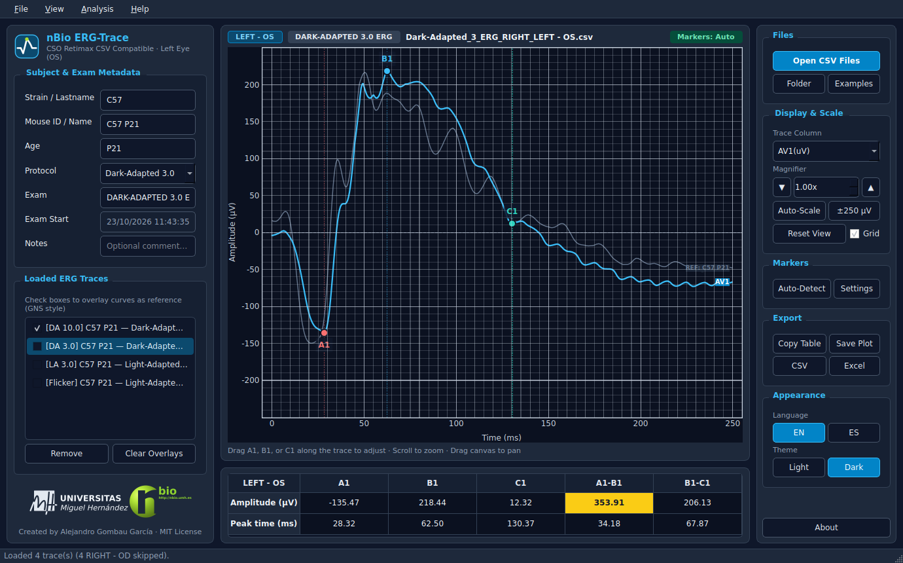

# nBio ERG-Trace

**Mouse electroretinography (ERG) viewer and amplitude analyzer for CSO Retimax CSV exports — available as a zero-install Web App and a native Desktop App.**

---

## Live Web App (No Installation Required)

> **Launch directly in your browser:** **[https://alexgomb.github.io/ERG_csv_reader/](https://alexgomb.github.io/ERG_csv_reader/)**

- **100% Local & Private:** All CSV parsing, waveform rendering, FFT analysis, and CSV/Excel exports run **exclusively inside your browser**. Your research CSV files never leave your device and are never uploaded to any server.
- **1:1 Numerical Parity with Desktop:** Shares the exact same raw-signal formulas, Retimax peak detection windows, and 30 Hz Flicker FFT math as the Python desktop engine, continuously verified against [`tests/golden_metrics.json`](tests/golden_metrics.json) across all 8 real CSO Retimax recordings.
- **Works on Any Computer:** Share the link with lab colleagues on Windows, macOS, or Linux — click **Examples** to test immediately or drag and drop your CSO Retimax CSVs/folders.

---

## Overview

**nBio ERG-Trace** is built for vision-science laboratories recording murine ERGs with the **CSO Retimax** system. It is available both as a **zero-install Web App** (React + TypeScript + Vite on GitHub Pages) and a **native desktop application** (Python + PySide6 + PyQtGraph). Both share the same Retimax-inspired interface focused on the **left eye (`LEFT - OS`)**, preserving **1:1 raw signal fidelity** (no artificial smoothing or baseline alteration) while adding modern batch loading, interactive cursor adjustment, reference overlays, manual protocol selection, 30 Hz Flicker analysis, bilingual EN/ES support, dark/light themes, and direct CSV/Excel export.

### Key Features

- **Left-Eye (`LEFT - OS`) Workflow:** Automatically identifies recorded eye from the internal CSO Retimax CSV header (not filename text) and filters out `RIGHT - OD` exports by default (configurable in *Settings*).
- **1:1 Raw Signal Fidelity:** Pure display controls (`±250 µV` Retimax scale, magnifier `0.25x–25x`, `▲`/`▼` scale steps, `Auto-Scale`, free zoom/pan, grid toggle, dynamic channel selector `AV1(uV)` / `GAV(uV)` / `AV2(uV)...`) without filtering or modifying underlying microvolt values.
- **Protocol-Aware Auto-Detection, Manual Protocol Override & Draggable Cursors:** Detects `Dark-Adapted 3.0`, `Dark-Adapted 10.0`, `Light-Adapted 3.0`, and `Light-Adapted 3.0 Flicker` protocols (or override manually via the sidebar dropdown), places `A1`, `B1`, and `C1` within configurable mouse physiological time windows (ms), and allows dragging cursors directly along raw samples with instant recalculation of `A1-B1` (highlighted yellow) and `B1-C1`.
- **Dedicated 30 Hz Flicker Metrics:** Automatically computes raw-signal mean peak-to-trough amplitude (± SD), FFT fundamental amplitude (~30 Hz), FFT peak-to-peak amplitude, dominant frequency, and cycle count for Flicker traces.
- **Multi-File / Folder Loading & Reference Overlays:** Drag and drop individual CSVs, multiple files, or mouse subfolders recursively. Check any trace in the sidebar to overlay it in muted gray (`GNS` reference style) behind the active waveform.
- **Batch Export & Work Sessions:** Export all loaded and manually verified records to **CSV** or formatted **Excel (`.xlsx`)**, copy the active metrics table to the clipboard, save high-resolution **PNG** or vector **SVG** plots, and save/reopen **JSON** work sessions preserving cursor adjustments, protocol overrides, and mouse metadata.
- **Bilingual (EN / ES) & Light / Dark Themes:** Switch language and theme live at any time; preferences and detection windows persist automatically across launches.

---

## Screenshots

### Light Mode (English) — Dark-Adapted 3.0 ERG with Dark-Adapted 10.0 Reference Overlay


### Dark Mode (English) — Dark-Adapted 3.0 ERG


### Light Mode (Spanish) — Light-Adapted 3.0 Flicker ERG (Auto-Scale & 30 Hz FFT Bar)


### Dark Mode (Spanish) — Dark-Adapted 10.0 ERG


---

## Installation & Quick Start

### Option 1: Run from Python (Windows / macOS / Linux)

Requires **Python 3.10+**.

```bash
git clone git@github.com:alexgomb/ERG_csv_reader.git
cd ERG_csv_reader

python -m venv .venv
# On Windows (PowerShell):
.venv\Scripts\Activate.ps1
# On macOS / Linux:
source .venv/bin/activate

pip install -e .
```

Launch the desktop app:

```bash
# Start empty (or pass CSV files / folders as arguments)
nbio-erg-trace

# Or start directly with the bundled CSO Retimax example files
nbio-erg-trace --examples

# Optional startup overrides
nbio-erg-trace --examples --lang es --theme dark
```

You can also launch via `erg-reader` or `python -m erg_reader`.

### Option 2: Standalone Windows Executable (`.exe`)

Tagged releases (`v*`) automatically trigger the GitHub Actions workflow (`.github/workflows/release-windows.yml`) to compile and attach a self-contained `nBio_ERG_Trace.exe` with bundled `example_files/`.

To build `nBio_ERG_Trace.exe` locally on Windows:

```powershell
pip install -e ".[dev]"
pyinstaller --clean --noconfirm packaging/erg_reader.spec
# Output: dist\nBio_ERG_Trace.exe
```

---

## CSO Retimax CSV Format Supported

The parser natively reads CSO Retimax tab-delimited exports with comma decimals (and dot-decimal fallbacks):

```text
Exam start: 23/10/2026 11:43:35
LEFT - OS
Time(ms)	GAV(uV)	AV1(uV)
0,	-3,881836	-3,881836
0,488281	-3,973389	-3,973389
...
```

Sample CSO Retimax recordings covering all four standard murine protocols (`Dark-Adapted 3`, `Dark-Adapted 10`, `Light-Adapted 3`, and `Light-Adapted 3 Flicker`) are included in [`example_files/`](example_files/) and can be loaded inside the app via **File → Load Example Files** (or the **Examples** button).

---

## Keyboard Shortcuts

| Shortcut | Action |
| --- | --- |
| `Ctrl+O` | Open CSV files |
| `Ctrl+Shift+O` | Open folder (recursive) |
| `Ctrl+S` | Save work session (`.json`) |
| `Ctrl+Shift+C` | Copy current Retimax metrics table to clipboard |
| `Ctrl+R` | Reset active trace markers (`A1`, `B1`, `C1`) to auto-detection |
| `Ctrl+0` | Reset waveform view |
| `G` | Toggle plot grid |
| `Ctrl+Q` | Exit |

---

## Development & Testing

Both the **Python desktop engine** (`src/erg_reader/`) and the **TypeScript web engine** (`web/src/`) are covered by automated unit, edge-case, and UI test suites, tied together by a shared cross-platform golden reference ([`tests/golden_metrics.json`](tests/golden_metrics.json)).

### Python Desktop Suite

```bash
pip install -e ".[dev]"

# Lint
ruff check src tests

# Automated unit, edge-case & headless Qt UI tests
QT_QPA_PLATFORM=offscreen pytest -v
```

### Web App (`web/`)

Requires **Node.js 22+**.

```bash
npm --prefix web ci

# Start local development server
npm --prefix web run dev

# Strict TypeScript check, oxlint, and Vitest unit + edge-case + Python golden parity tests
npm --prefix web run typecheck
npm --prefix web run lint
npm --prefix web test

# Production build for GitHub Pages
VITE_BASE=/ERG_csv_reader/ npm --prefix web run build
```

---

## Changelog

### [0.2.0] — 2026-11-27

#### Added
- **Zero-Install Web App (`web/`):** Complete 100% client-side React + TypeScript + Vite single-page application deployed automatically to GitHub Pages at **[https://alexgomb.github.io/ERG_csv_reader/](https://alexgomb.github.io/ERG_csv_reader/)** with 1:1 visual, functional, and numerical parity with the desktop app (raw CSO Retimax CSV/folder drag-and-drop, interactive SVG waveform canvas with draggable `A1`/`B1`/`C1` cursors, reference overlays, manual protocol selector, 30 Hz Flicker FFT analysis, CSV/Excel/PNG/SVG/JSON export, Light/Dark themes, and EN/ES i18n).
- **Automated GitHub Pages Deployment & Dual-Platform CI:** Added `.github/workflows/deploy-pages.yml` and expanded `.github/workflows/ci.yml` to run both Python (`ruff` + `pytest` on Ubuntu & Windows) and Web (`tsc` + `oxlint` + `vitest` + `vite build`) on every push and pull request.
- **Comprehensive Unit, Edge-Case & Cross-Platform Golden Parity Tests:**
  - Expanded Python test suite (`test_parser_edge_cases.py`, `test_analysis_edge_cases.py`, `test_exporters_edge_cases.py`, `test_ui.py`) covering BOM/CP1252/dot-decimal/malformed CSVs, short/flat/degenerate signals, zero-crossing `C1`, out-of-bounds markers, Unicode CSV/Excel/JSON round-trips, EN/ES i18n parity, and pure-vector SVG asset checks.
  - Added Vitest + Testing Library web test suite (`parser.test.ts`, `analysis.test.ts`, `exporters.test.ts`, `architecture.test.ts`, `app.test.tsx`) validating 1:1 numerical parity against `tests/golden_metrics.json` across all 8 real CSO Retimax CSVs, SciPy-identical peak tie-breaking, multi-sheet `.xlsx` round-trips, recursive directory drag-and-drop, and corrupt `localStorage` recovery.

#### Fixed
- Fixed edge cases in `src/erg_reader/analysis.py` for empty arrays (`n = 0` previously yielded `b1_idx = -1`) and zero-timestep inputs (`dt_ms = 0` previously raised `ZeroDivisionError` in `rfftfreq`).

### [0.1.2] — 2026-11-26

#### Added
- Manual **Protocol** selector dropdown in the left sidebar (`Dark-Adapted 3.0`, `Dark-Adapted 10.0`, `Light-Adapted 3.0`, `Light-Adapted 3.0 Flicker`, `Custom / Unknown`) to override automatic protocol classification at any time, immediately toggling the 30 Hz Flicker analysis bar and recalculating automatic markers while preserving manual cursor edits.
- Manual protocol overrides are now saved and restored inside `.json` work sessions.

#### Improved
- Prioritized the 140–185 ms recording duration check in `infer_protocol` so renamed 30 Hz Flicker CSVs without `"flicker"` in their filename are still auto-detected accurately.

### [0.1.1] — 2026-11-26

#### Added
- Pure vector SVG **UMH · nBio** institutional logo (`umh_nbio_light.svg` / `umh_nbio_dark.svg`) rendered at 2× HiDPI in the left sidebar and About dialog, adapting cleanly to Light and Dark modes.
- Added institutional affiliation in the About dialog: **Grupo nBio · Instituto de Bioingeniería · Universidad Miguel Hernández** (`http://nbio.umh.es`).
- Bundled SVG assets in both `pyproject.toml` package data and the PyInstaller `nBio_ERG_Trace.exe` Windows release build.

### [0.1.0] — 2026-11-26

#### Added
- Initial release of **nBio ERG-Trace** desktop application (`PySide6` + `PyQtGraph` + `NumPy` + `SciPy` + `OpenPyXL`).
- CSO Retimax CSV parser supporting comma/dot decimals, CRLF/UTF-8/CP1252 encodings, dynamic average columns (`AV1`, `GAV`, `AV2`...), and strict internal eye-header detection (`LEFT - OS` vs `RIGHT - OD`).
- Retimax-inspired left-eye (`LEFT - OS`) desktop interface with editable subject/exam metadata, recursive drag-and-drop CSV/folder loading, and checkable reference waveform overlays (`GNS` style).
- Protocol-aware automatic detection (`Dark-Adapted 3.0`, `Dark-Adapted 10.0`, `Light-Adapted 3.0`, `Light-Adapted 3.0 Flicker`) with configurable mouse physiological time windows (ms) and draggable `A1`/`B1`/`C1` cursors snapped 1:1 to raw samples.
- Retimax-style metrics table (`Amplitude (µV)` and `Peak time (ms)` for `A1`, `B1`, `C1`, highlighted `A1-B1`, `B1-C1`) plus dedicated 30 Hz Flicker analysis bar (mean peak-to-trough ± SD, FFT fundamental & peak-to-peak, dominant frequency, cycles).
- Pure display controls (`±250 µV`, magnifier `0.25x–25x`, `▲`/`▼` scale steps, `Auto-Scale`, zoom/pan, grid toggle, trace column selector).
- Batch export to UTF-8 CSV and formatted Excel (`.xlsx`), clipboard TSV copy, high-resolution PNG and native SVG plot export, and `.json` work session save/load.
- Live English / Spanish (`EN`/`ES`) localization and Light / Dark themes with `QSettings` persistence.
- Bundled CSO Retimax `example_files/`, automated `pytest` + `pytest-qt` test suite, PyInstaller Windows `.spec`, and GitHub Actions CI & Windows `.exe` release workflows.
- MIT License and in-app attribution.

---

## Contributors & License

- **Author:** Alejandro Gombau García · Grupo nBio, Instituto de Bioingeniería, Universidad Miguel Hernández
- **Contributors:** [Gemini](https://github.com/gemini-code-assist) (`@gemini-code-assist`) & [Antigravity](https://github.com/apps/antigravity-for-github)
- **License:** [MIT License](LICENSE)
